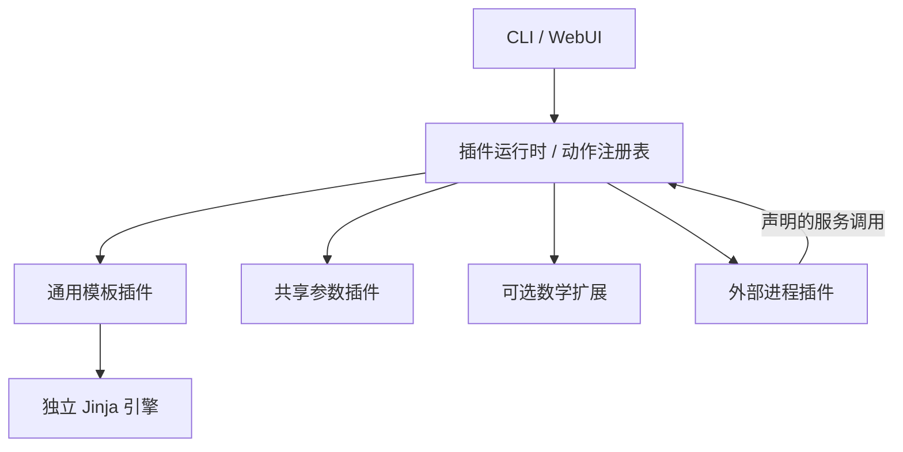

# NCtool 架构与依赖边界

适用于当前 2.3.0 CLI/WebUI（未发布）与 2.0.0 核心组件；外部进程协议 2，版本化服务独立。操作入口见[文档总览](README.md)，字段与路由见[系统设计](SYSTEM_DESIGN.md)，当前限制见[项目状态](PROJECT_STATUS.md)。

默认产品是通用 Jinja 模板平台；内置 NC 能力已移除，领域能力通过开放的通用插件机制提供，数学扩展独立可选。借鉴 [DeepSeek Harness](https://github.com/deepseek-ai/deepseek-harness/blob/master/docs/architecture.md) 和 [Cordis](https://github.com/deepseek-ai/deepseek-harness/blob/master/docs/cordis-primer.md) 的服务上下文、依赖声明、作用域注册与可撤销生命周期设计，在 Rust workspace 中实现。

## 依赖规则

- `nctool-tpl` 只依赖 MiniJinja；不包含领域模型、数学默认扩展或加工 lint。
- SDK、运行时、模板与参数服务不依赖任何领域实现。
- CLI 的 `composition` 是唯一装配入口；默认装配 `template` + `parameters`，不引入内置 NC/工序插件。域外能力只能通过通用插件机制扩展。
- 默认构建不含 math 依赖；完整发行包包含可选 math 实现，默认配置仍只启用 `template` + `parameters`。
- 数学插件以独立 `math = ["dep:nctool-plugin-math"]` feature 编译，保持领域中立；构建可用、运行启用（配置 `enabled`）与单次 `extensions` 选择分别显式，选择进入输入签名与历史重放。
- 所有业务调用使用显式服务或动作，观测扩展使用 `ActionStarted` / `ActionFinished` 事件。事件不更改正文或吞掉执行错误。

## 渲染数据流

普通渲染：模板资产或源码 + JSON 上下文 → 通用规格/defaults → 显式渲染扩展 → Jinja → 文本/诊断。

受管渲染：普通模板输入 + 共享参数绑定/预置 → 参数解析（定义默认 → 模板默认 → 显式预置 → 人工输入）→ 冻结快照 → 通用渲染服务（显式扩展）→ 文本/诊断。冻结形式（snapshot + parameter_snapshot + parameter_request）不能混用 context、schema、defaults、bindings 或 preset_id。

过滤器属于新建的单次渲染环境，不修改全局 Environment。重名扩展、重名过滤器和覆盖 Jinja 内置过滤器都报错。

## 生命周期

启动前验证插件协议、版本、服务绑定、动作 Schema 和全部依赖。拓扑排序后逐个激活，成功后发布动作、服务、过滤器和监听器；失败时释放当前插件及已启动插件。关闭时按依赖逆序停止，注册表和作用域监听器一并释放。

多服务提供方必须通过配置明确选择；动作 ID 使用插件命名空间避免冲突。提供方用不同动作 ID 实现同一个稳定服务 ID，消费者只知道服务接口。

外部进程有独立读写线程。读线程按请求 ID 路由响应，宿主回调在线程中执行，避免等待外部响应时堵住逆向调用。取消或超时只终结对应请求（并通知插件）而不终止进程；协议错误、进程退出或全部并发槽位都被已放弃的请求占满时才终止失效进程，下一次调用重新握手。调用结果不自动重试。

## 旧版边界

原 `nctool-core` 已拆分并退出 workspace，旧业务模板与嵌入资产已移除。旧 Tauri 桌面 GUI 源码、依赖清单与启动入口已移除；当前 CLI/WebUI 不依赖 Tauri。历史架构快照不是当前接口规范。

旧架构、GUI 和迁移资料见[历史归档](archive/README.md)。

## WebUI 工作台与宿主

当前入口为 ui/src/main.tsx → App.tsx，Ant Design 提供组件与主题，React Router 使用 Hash 路由，TanStack Query 管理工作区服务端状态及轮询，Zustand 管理新版独立草稿；CodeMirror 按需加载。页面按 workbench/history/parameters/plugins/help 分组，应用壳负责导航、模板目录和活动任务。旧 App 状态模型和旧浏览器存储不迁移，详见[WebUI 直接重写](UI_REWRITE.md)。

宿主负责异步任务、取消、工作区与执行历史。模板任务冻结源码集合与参数；任务文件原子写入，活动任务持有 OS 文件锁，历史列表使用可重建轻量索引。重执行比较声明版本、服务绑定及启动时内容/公开配置指纹，新记录另存来源，不改原记录；观察指纹不固定程序或外部环境。历史维护、隐私投影和有界调用诊断见[运行维护](OPERATIONS.md)。

能力驱动页面与动作，未知视图退回通用 Schema 表单，不运行第三方前端脚本。文档动作声明输入绑定；Schema 由服务端最终校验。集合导入导出由插件贡献，宿主调度并在后续失败时按 receipt 尝试回滚；这不是跨插件数据库事务。

宿主响应类型、运行时校验与错误诊断见[宿主与插件契约](CONTRACTS.md)。动态插件数据与资产扩展字段保持开放，数值使用无损 JSON。字段路径与模板位置分别记录；外部协议为 2，旧协议明确拒绝。

## 基线与发布

`scripts/source_baseline.py` 为包含未提交改动的完整源码工作树生成恢复归档、Git 状态/补丁及逐文件校验清单，不修改索引。该本地快照与正式 Git 提交分别追踪；忽略的运行资产需独立备份。

标签发布依赖复用的完整 CI；验证完成后才按明确的 Rust target 构建发行二进制和校验文件。配置的三平台检查需取得实际运行证据。

本地构建与快照步骤见[贡献指南](CONTRIBUTING.md)，标签及发行资产规范见[发布说明](RELEASE.md)。
