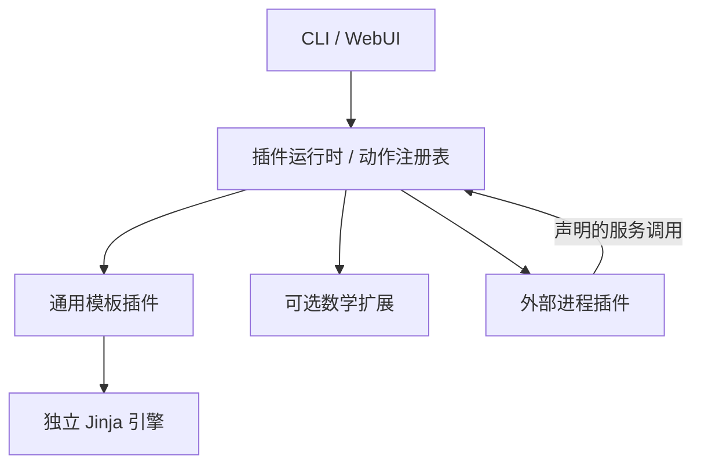

# NCtool 架构与依赖边界

适用于当前 2.2 CLI/WebUI 与 2.0 核心组件。操作入口见[文档总览](README.md)，字段与路由见[系统设计](SYSTEM_DESIGN.md)，当前限制见[项目状态](PROJECT_STATUS.md)。

默认产品是通用 Jinja 模板平台；内置 NC 能力已移除，领域能力通过开放的通用插件机制提供，数学扩展独立可选。借鉴 [DeepSeek Harness](https://github.com/deepseek-ai/deepseek-harness/blob/master/docs/architecture.md) 和 [Cordis](https://github.com/deepseek-ai/deepseek-harness/blob/master/docs/cordis-primer.md) 的服务上下文、依赖声明、作用域注册与可撤销生命周期设计，在 Rust workspace 中实现。

## 依赖规则

- `nctool-tpl` 只依赖 MiniJinja；不包含领域模型、数学默认扩展或加工 lint。
- SDK、运行时、模板与参数服务不依赖任何领域实现。
- CLI 的 `composition` 是唯一装配入口；默认装配 `template`，不引入内置 NC/工序插件。域外能力只能通过通用插件机制扩展。
- 默认构建不含 math 依赖；完整发行包包含可选 math 实现，默认配置仍只启用 `template` + `parameters`。
- 数学插件以独立 `math = ["dep:nctool-plugin-math"]` feature 编译，保持领域中立；构建可用、运行启用（配置 `enabled`）与单次 `extensions` 选择分别显式，选择进入输入签名与历史重放。
- 所有业务调用使用显式服务或动作，观测扩展使用 `ActionStarted` / `ActionFinished` 事件。事件不更改正文或吞掉执行错误。

## 渲染数据流

普通渲染：模板资产或源码 + JSON 上下文 → 通用规格/defaults → 显式渲染扩展 → Jinja → 文本/诊断。

渲染：模板 `schema` 描述参数，`defaults` 提供初始值，本次 `context` 覆盖同名顶层值 → 通用渲染服务（显式扩展）→ 文本/诊断。参数随模板保存，不经过独立共享服务。

过滤器属于新建的单次渲染环境，不修改全局 Environment。重名扩展、重名过滤器和覆盖 Jinja 内置过滤器都报错。

## 生命周期

启动前验证插件协议、版本、服务绑定、动作 Schema 和全部依赖。拓扑排序后逐个激活，成功后发布动作、服务、过滤器和监听器；失败时释放当前插件及已启动插件。关闭时按依赖逆序停止，注册表和作用域监听器一并释放。

多服务提供方必须通过配置明确选择；动作 ID 使用插件命名空间避免冲突。提供方用不同动作 ID 实现同一个稳定服务 ID，消费者只知道服务接口。

外部进程有独立读写线程。读线程按请求 ID 路由响应，宿主回调在线程中执行，避免等待外部响应时堵住逆向调用。取消或超时只终结对应请求（并通知插件）而不终止进程；协议错误、进程退出或全部并发槽位都被已放弃的请求占满时才终止失效进程，下一次调用重新握手。调用结果不自动重试。

## 旧版边界

原 `nctool-core` 已拆分并退出 workspace，旧业务模板与嵌入资产已移除。旧 Tauri 桌面 GUI 源码、依赖清单与启动入口已移除；当前 CLI/WebUI 不依赖 Tauri。历史架构快照不是当前接口规范。

旧架构、GUI 和迁移资料见[历史归档](archive/README.md)。

## 2.2 WebUI 工作台

独立 React/TypeScript 前端由 Vite 构建，通过编译期静态资源表嵌入 Rust 服务。CodeMirror 提供 Jinja/JSON/输出编辑视图，结构化参数控件按 Schema 递归渲染，数值全程保留原始字面量。浏览器草稿采用隔离的工作区存储。

宿主 Workbench 层负责通用异步任务、取消、工作区标识与记录，不导入任何领域模型。通用模板任务在执行前冻结模板集合，并把实际输入和快照写入记录。任务文件使用原子写入，活动任务持有 OS 文件锁；其他进程启动不会把仍在运行的任务标为中断。任务列表读取单独的轻量索引，避免加载所有历史产物。

插件以 Panel.view 选择已注册的前端视图。领域专用视图由插件贡献并按需载入；未知视图回退到通用 Schema 表单，不运行第三方前端脚本。动作的可选 ui_schema.properties 提供显示提示，document_input 声明文档工作台的输入绑定与元数据匹配；后端校验仍以 input_schema 为准。

配置预检查与启动共用运行时的纯依赖解析函数；预检查读取描述和 Schema，不启动插件进程或创建领域资产。集合导入导出通过描述中的 asset_collections 动作扩展，宿主只调度集合，不导入具体资产类型。内置资产操作用工作区分组锁取得一致的短时快照，执行和渲染不持有整段锁。

动作服务可返回 replay_input，记录原始模板快照与冻结参数。Workbench 重执行优先采用它；提供方没有该字段时使用原始输入。历史差异比较在前端进行，不修改记录。

执行历史页面的列表、详情、差异比较和重执行请求集中在 `ui/src/components/HistoryPage.tsx`；应用壳继续持有共享任务状态与文档恢复逻辑，页面切换保留已选记录及比较状态。

Workbench 在任务创建时记录宿主/插件版本和服务绑定；只读重执行预检查显示差异，新任务另外记录历史来源和实际比较结果。该记录跟踪声明版本，不固定插件二进制或配置。工作区资产包读取、预检查、导入确认和刷新流程集中在 `ui/src/components/WorkspaceImport.tsx`，保留后端集合校验与回滚边界。

## 基线与发布

`scripts/source_baseline.py` 为包含未提交改动的完整源码工作树生成恢复归档、Git 状态/补丁及逐文件校验清单，不修改索引。该本地快照与正式 Git 提交分别追踪；忽略的运行资产需独立备份。

标签发布依赖复用的完整 CI；验证完成后才按明确的 Rust target 构建发行二进制和校验文件。配置的三平台检查需取得实际运行证据。

本地构建与快照步骤见[贡献指南](CONTRIBUTING.md)，标签及发行资产规范见[发布说明](RELEASE.md)。
