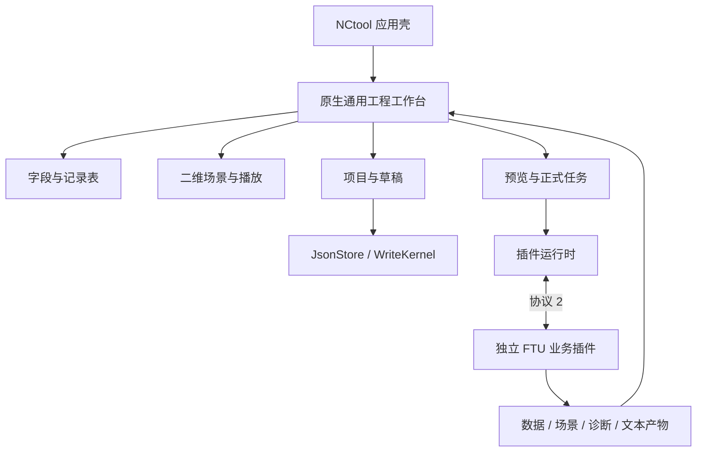

# 通用工程工作台与 FTU 功能重实现计划

> 本文保留设计依据。后续已按用户授权实施，当前使用与接口见[工程工作台](ENGINEERING_WORKBENCH.md)，FTU 的 NC 采用 Jinja 模板与渲染后校验。以下“尚未实施”为制定计划时的状态，不描述当前工作树。

更新：2026-10-24。用户明确：底座需要具备相关基础能力，FTU 代码无需照抄，可以采用其他技术栈复现。本计划取代此前“原页面 + iframe + Node.js 适配”的主路线。本轮只修订计划，不实施功能、不修改原 FTU、不提交或发布。

当前事实依据为[架构](ARCHITECTURE.md)、[插件规范](PLUGIN_INTEGRATION_SPEC.md)及[FTU 源码核对](FTU_PLUGIN_MIGRATION.md)。以下新增能力、模块和格式均为提案，尚不属于已发行功能。

## 1. 目标与能力边界

NCtool 原生提供工程工作台：参数和特征编辑、二维场景、诊断定位、项目管理、计算预览、生成与导出。FTU 是首个业务案例，按功能与数值契约重新实现，不受原文件组织、DOM、语言或页面布局约束。

| 底座原生能力 | FTU 业务插件 |
| --- | --- |
| 工作台布局、导航、分组表单、可重复记录表 | 精车数据结构、参数含义和约束 |
| 二维图元、视口、选择/高亮、路径播放 | 轮廓、倒角/圆角、进退刀及轨迹计算 |
| 项目保存、草稿、撤销重做、冲突处理 | 输入规范化、工艺和几何校验 |
| 预览调度、正式任务、取消、结果资格与历史 | 简化毛坯/禁入区、逐段进给、恒线速度 |
| 通用序列化、文件导入与文本产物交付 | 业务导出内容、SINUMERIK 格式规则 |

后续插件通过声明和数据复用这些能力，无需重做整页前端。精车模型仍归独立业务插件，根 Jinja 引擎、SDK、资产与模板/参数插件保持领域中立，不恢复内置 NC、退役身份、旧 profile 或新增 FTU feature。

首版功能参考原 FTU：内外圆、轮廓与连接修饰、独立进退刀、进给和恒线速度、简化毛坯/禁入区、图形选择/缩放/平移/播放、项目打开保存、JSON/CSV/SVG/SPF 导出。允许改善交互和实现，不要求像素或源码一致；仍维持理想接触点轨迹的业务边界。

## 2. 推荐技术路线

| 层次 | 建议 | 取舍 |
| --- | --- | --- |
| 工作台界面 | 沿用当前 React + TypeScript + Ant Design | 统一组件、布局、表单、表格、路由和诊断交互 |
| 二维视图 | 首版原生 SVG 场景组件 | 显示解析线/圆弧、选择和标注；先测量，再决定 Canvas 等优化 |
| 会话/服务端状态 | 当前 Zustand / TanStack Query | 抽出通用文档与执行状态，不给模板 Draft 堆 FTU 字段 |
| 存储与任务 | Rust 宿主、JsonStore/WriteKernel、现有任务/历史 | 沿用指纹、原子写入、取消和追溯 |
| FTU 计算 | 优先独立 Rust 外部插件 | 与宿主采用一致语言生态，目标发行免装 Node/Python；独立构建和分发 |
| 插件契约 | 现有进程协议 2 + 独立版本化工作台清单 | 首版不依赖任意前端脚本或 iframe |

Rust 是本项目重实现的建议，不限制其他插件语言。外部 Rust 插件各平台分别构建，独立锁定依赖，不作为 CLI 生产依赖，也不加入默认 Rust workspace。选择依据是当前宿主技术和部署目标，不是要求逐行翻译 TypeScript。

## 3. 原生声明式工作台

增加宿主内置的通用工程工作台视图，插件声明页面、项目类型、字段/表格、分组、视图区、预览动作与生成动作。FTU 不携带任意 JavaScript 页面；宿主读取声明后组合自己的组件，统一生命周期、焦点和错误恢复。

建议以独立 `nctool.package.json` 和 format_version:1 承载工作台/项目能力声明，保留当前 plugin.json 与 describe 的严格形状。capabilities 发布支持的视图和数据格式版本，未知必需能力或坏声明明确失败，不能悄悄改用普通模板。字段在最小原型阶段固定，再写入正式规范。

声明仅支持白名单组件、JSON Pointer 绑定、动作引用和有限条件显示，不支持 eval、任意表达式或注入 HTML。后端仍进行完整校验，声明不授予任意磁盘或服务权限。先实现 FTU 所需的枚举控制分组等有限规则，不造通用脚本语言。

编辑器至少提供数值草稿、枚举、开关、可选分组、重复记录表、行新增/复制/删除/排序及稳定行 ID。图形和表格共享 selection ID；诊断可定位记录或字段。插件声明圆柱/锥面等业务选项，宿主只理解通用类型和绑定。

默认布局包含参数、视图、诊断与结果区域，窄屏可切换区块。保留键盘等价操作，计算刷新不得重建整页或丢失编辑焦点。底座保存选择、滚动及面板状态，业务项目与临时视图状态分开。

## 4. 二维场景、联动与播放

新增版本化 Scene2D：线、圆弧、折线、点、文本、样式层和稳定元素 ID，可选 entityRef/fieldPath 用于定位。协议明确右手坐标、圆弧方向/扫角、单位、轴标签、边界和可见层。宿主负责绘制及数学坐标到屏幕的映射，不做精车求交和切削判断。

通用组件提供等比例缩放、平移、全图适配、命中、高亮和框选的必要子集。半径坐标与直径刻度通过显式轴显示变换表达，不能让组件识别机床 X/Z 名称。验证有限数值、圆弧一致性和元素数量；坏场景明确报错，不静默丢段。

路径播放使用有序段及长度/参数化位置，提供暂停、跳转、进度拖动；插件提供业务顺序。宿主通用路径采样仅用于展示，不生成加工程序。切页暂停，卸载清理事件与动画。视口变化不影响几何计算签名；若导出当前视口，它应进入导出选项签名。

SVG 导出复用解析场景，保留真实圆弧；标签安全转义，不接受插件注入任意 SVG/HTML。通用 CSV 工具处理转义及防公式解释，业务列由插件声明。JSON 保留结构；SPF 的所有加工语义由 FTU 实现。

首版先按 FTU 最大规模验证 SVG 绘制与选取，原型阶段明确性能预算、机器及样例，再决定 Canvas、空间索引等优化，不预先添加完整 CAD 引擎。

## 5. 项目、草稿与编辑事务

文档按 workspace/plugin/kind/id 隔离，建议存于 `<workspace>/.nctool/plugin-data/<plugin-id>/<kind>/<id>.json`。服务只接收限定标识，不接受任意路径。复用 JsonStore：expected:null 为新建，更新/删除要求旧指纹；冲突保留草稿并提供重新加载或另存，不自动覆盖。

封装包含通用格式版本、业务数据版本和 payload；存储与执行 Schema 分开，未完成或几何无效的项目也可保存。数值原文与有效值分离，NaN/Infinity 不进入持久 JSON 或执行请求。非法草稿不得使用旧有效输入继续生成。

提供有界撤销/重做与编辑事务：一次行操作或连续字段编辑作为用户可理解的编辑单元，恢复参数和相关选择；不撤销已经提交的文件写入或外部副作用。刷新恢复草稿、基准指纹和任务关联，undo 历史首版可仅在会话内保留。

提供统一文件打开入口、导入预检查和 JSON 导出；业务解析/转换由插件实现。原 FTU version:1 文件作为参考样例，是否提供正式旧项目导入器在功能基线中明确，不默认兼容所有旧数据。新版数据格式与默认规则可以重新设计。

通用文档集合复用资产包预检查、receipt 和回滚机制。卸载保留项目数据，重装后按版本检查；缺插件或类型时拒绝相关集合导入。跨插件数据访问须显式契约，不能通过更换 plugin_id 读取别人的项目。

## 6. 预览、正式执行与结果资格

新增去抖预览调度：结构有效时调用插件分析，关联草稿修订并取消或丢弃过期请求。预览仅展示场景与诊断，通常不写完整历史，也不交付加工产物；服务端仍实施输入验证、限流、并发和超时。预览不能长期占满正式生成容量，不另造第二套持久任务系统。

正式生成冻结当次输入与规范化默认值，从输入重算，进入既有任务和历史，全部所选格式校验通过后整体返回产物。失败、取消、中断或输入变化后不得作为当前成品。下载资格由宿主执行状态和签名决定，历史原产物保留明确的独立出口。

预览和生成使用同一 Rust 业务核心，首版通过常驻外部进程调用；先测量往返和计算时延，不要求同时实现 WASM 或浏览器算法。外部插件的接收循环与计算 worker 分离，在长计算中检查 Cancellation，遵守现有超时、迟到响应和进程恢复语义，不自动重试未知副作用。

签名包含业务输入、生成选项、规范化规则版本和实际环境；视图选择/播放进度不影响几何签名。诊断沿用 SDK 的 level/code/message/path，实体定位先放 data 中的映射；如扩展 Diagnostic 字段，须单独明确版本及序列化兼容，不能直接加入未知字段。

## 7. FTU 重实现与正确性

动作候选为 `ftu.analyze({project})` 与 `ftu.generate({project,formats,export_options})`。结果包括业务数据、Scene2D、诊断定位、文本 artifacts 和满足同一动作 Schema 的 replay_input。业务数据、场景、算法和进程协议分别管理版本。

算法按行为拆分：轮廓模型、线/圆弧几何、倒角/圆角、进退刀、方向与反向、毛坯/禁入区、逐段工艺、导出。模块边界按新实现确定，不照搬旧文件。底座不承担这些精车算法。

原 FTU 是参考实现，不是唯一正确性判据。采用四类证据：手算/解析算例、边界及不变量、旧实现差分、固定业务样例。明确长度/角度容差、连续/相切、圆弧极值、单位和段归属；差异先查原因，不机械保留旧缺陷，也不以旧界面截图代替业务验收。

保留必须的业务语义：每转进给随几何段绑定、恒线速度与最高转速、内外圆定义、反向只改变遍历语义、非法尺寸不静默修正。独立验证 SPF 模态顺序、圆弧方向、编码/换行和精度阻断。设备/OEM、刀尖补偿和碰撞验证仍在本次功能之外。

不要求继续生成原单文件 FTU.html；首版离线定义为发行宿主和插件断网可用。独立 HTML、WASM 或其他部署形态如确有需求再单独计划。原 FTU 项目保留作为参考，不在重实现过程中覆盖或删除。

## 8. 实施阶段及退出门槛

| 阶段 | 交付物 | 退出门槛 |
| --- | --- | --- |
| P0 功能契约 | 功能矩阵、解析算例、数值/单位规范、交互流程、两仓变更基线 | 必做与可改善行为明确，原项目不变，不受旧代码结构约束 |
| P1 通用原型 | 原生表格、Scene2D、选择联动、路径播放和无加工业务的示例插件 | 无 FTU 专属分支，最大规模真实浏览器验证，固定清单/场景契约 |
| P2 数据闭环 | 项目、草稿/撤销、指纹冲突、文件导入导出和资产包 | 空值可恢复且不可误执行，多窗口冲突/回滚通过 |
| P3 执行底座 | 去抖预览、过期响应、正式任务、取消/恢复和统一历史 | 连续编辑不串结果，预览不挤死生成，失败取消无当前成品 |
| P4 FTU 重实现 | 独立 Rust 插件、工作台声明、完整编辑与导出 | 解析/不变量/差分验证通过，图形/诊断/文件内容一致 |
| P5 交付验收 | 平台插件包、回归/性能/依赖报告、插件作者规范 | 声明平台实测，无源 FTU 或 Node 依赖，第二个插件可复用底座 |

原型阶段测量预览、绘制、表格及最大文档规模后细化预算，不承诺未经验证的毫秒数。各阶段报告绑定源码与宿主/插件哈希，不用旧测试数字作为新结果。

FTU 文件可读，但此前 `git -C ../FTU status` 因沙箱权限失败；实施前仍需取得只读状态基线。外部 Rust 插件独立目录、独立 Cargo.lock 和构建验证，不加入默认 workspace，也不引入额外宿主编译 profile。

## 9. 修改范围与验收

| 区域 | 工作 |
| --- | --- |
| `ui/src/components/` 及新工程工作台模块 | 编辑记录表、场景、视口、播放、诊断联动与布局 |
| `ui/src/state/` 与执行模块 | 通用文档、编辑事务、预览调度、执行修订与结果资格 |
| runtime 配置/追溯 | 工作台清单、能力检查、安装/启动及包指纹 |
| CLI composition/server/workbench/history | 通用文档服务、预览/任务入口及产物交付 |
| SDK 与文档 | 版本化视图/场景/项目契约，必要协议变更单独审查 |
| 独立 FTU 目录 | Rust 业务核心、动作、工作台声明、测试与各平台构建 |

验收覆盖：双插件隔离、非法绑定、无损 JSON、半径/直径显示、圆弧方向、表格/图形联动、键盘操作、撤销、冲突、刷新、取消、旧响应、过期产物、资产导入回滚和全部业务/文件格式。

按贡献指南执行适用的前端 lint/test、资源生成/--check、Python 检查、Rust workspace --locked 测试/Clippy/MSRV、依赖审计及现有浏览器回归。外部 Rust 插件以独立 --locked 流程检查；新增算法采用能证实边界的测试，不以镜像实现的测试数量充当证据。

当前没有新增依赖；实施前按具体库核对锁文件和官方文档，不因重实现而整体升级工具链。完成说明必须列出支持平台、性能、格式版本、当前限制和未验证项。提交、推送、合并和发布继续遵守单独授权范围。
