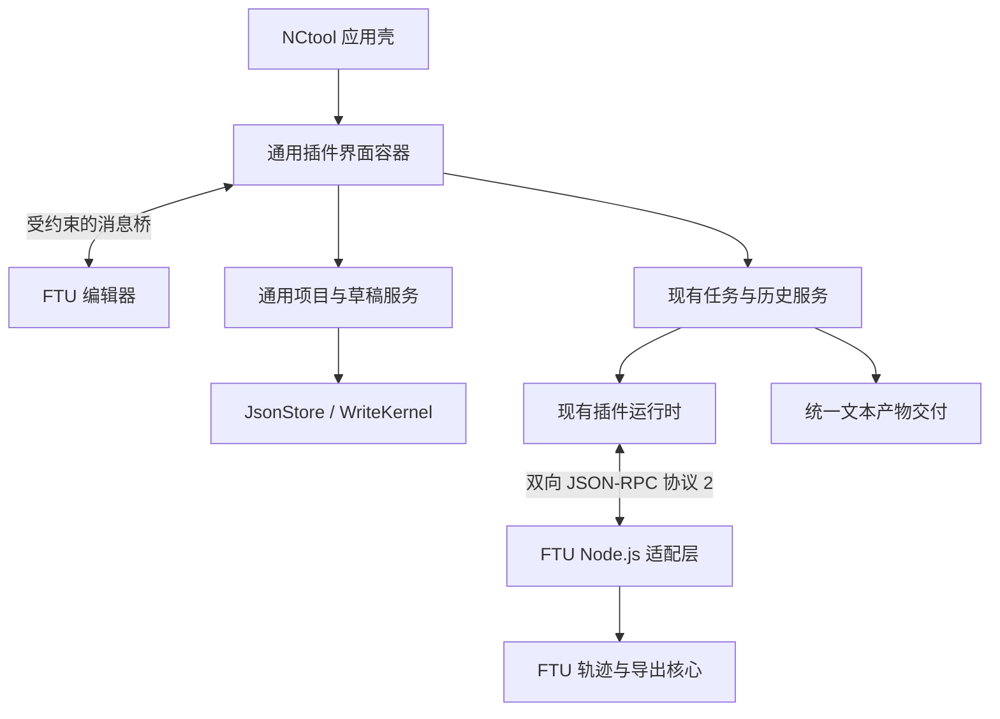

# 以 FTU 接入推动通用插件底座扩展：实施计划

> **本方案已被替代。** 用户明确底座应具备相关原生能力，FTU 可换技术栈复现。当前主路线见[通用工程工作台与 FTU 重实现计划](ENGINEERING_WORKBENCH_PLAN.md)。以下 iframe、Node 和原源码复用等内容仅保留为先前方案记录，不作为现行实施要求。

日期：2026-10-24。范围：用户已明确允许根据 FTU 需要规划通用基础能力扩展；本次只制定计划，不实施迁移、不改动原 FTU、不提交或发布。目标是让 FTU 以完整工作台插件接入，并让后续同类项目复用这些基础能力。

当前依据为 [FTU 源码核对](FTU_PLUGIN_MIGRATION.md)、[架构](ARCHITECTURE.md)、[现行插件规范](PLUGIN_INTEGRATION_SPEC.md)及实际 SDK/runtime/CLI/WebUI 源码。下文新增文件、字段、服务和接口均是设计提案，尚不存在于已发行版本。

## 1. 目标与范围

用户操作路径：安装 FTU 插件 → 启用并重启宿主 → 从侧栏打开“精车轨迹” → 新建或打开项目 → 编辑轮廓和进给 → 查看图形与诊断 → 生成并导出 → 从统一历史查看或重新执行。

首版保留 FTU 的外圆/内孔、轮廓特征及连接修饰、独立进退刀、逐段进给与恒线速度、毛坯/禁入区、图形定位/缩放/平移/播放、项目打开保存，以及 JSON/CSV/SVG/SPF 导出。未完成和非法几何允许保存继续编辑，但不能生成有效加工产物。

| 通用底座负责 | FTU 插件负责 |
| --- | --- |
| 插件界面资源加载、导航、生命周期与消息桥 | 轮廓编辑器、图形与播放交互 |
| 按插件隔离的项目保存、指纹冲突、草稿恢复 | 项目数据格式、结构/几何/工艺校验 |
| 动作任务、取消、历史、环境检查、统一产物交付 | 轨迹计算、SINUMERIK 输出及业务诊断 |
| TypeScript 接入工具、打包检查与验收夹具 | FTU 核心、业务示例与领域回归用例 |

底座代码不得出现圆柱、圆角、刀具、G96 等 FTU 模型或判断。只有插件目录及其测试包含这些实现。保留原有模板、共享参数、math 和无自定义界面的外部插件。首版不增加插件市场、远程更新、通用 DAG、云同步、二进制产物系统或几何引擎重写。

## 2. 总体技术路线



采用 **插件自带静态界面 + iframe 容器 + 消息桥 + Node.js 外部进程**。FTU 无须改写为 React；宿主也不直接 import FTU 的业务模块。前端包与后端进程随同一个插件包安装，版本和内容指纹一起追踪。

不把新的界面字段硬塞到当前 `PluginDescriptor`：它及 ExternalManifest 使用 deny_unknown_fields，且 describe 会比较规范化后的描述。建议新增独立的宿主包清单 `nctool.package.json`，以 `format_version:1` 管理界面、项目类型、最低宿主能力。现有 `plugin.json` 与进程协议 2 保持原形。界面消息桥独立使用 `bridge_version:1`，项目封装再独立版本化。

新宿主没有 sidecar 的包继续按现有方式处理；有 sidecar 时必须验证归属 ID、能力要求、入口资源和动作引用，不能读取失败后悄悄退回通用表单。旧宿主不提供新工作台能力，插件明确声明所需宿主服务并在发行说明注明最低宿主版本。首版不做任意旧宿主的兼容适配器。若 P1 原型证明需改变 RPC 帧或握手，再单独升级进程协议及配套测试，不能默默改变版本 2 的含义。

## 3. 基础能力 A：插件自带界面

### 3.1 包清单与资源加载

建议包布局：

```text
ftu/
  plugin.json                  # 动作、服务与进程入口
  nctool.package.json          # 宿主侧扩展清单，独立格式版本
  backend/plugin.cjs           # 编译后的 Node 适配层和核心
  frontend/index.html
  frontend/app.js
  frontend/app.css
  schemas/project.json
  README.md
```

sidecar 表达插件 ID、要求的宿主功能、页面 ID/标题/入口/关联动作、文档类型和 Schema 引用；首次只支持一个本地静态前端目录与有限入口，不支持 CDN、任意 URL 或运行时下载代码。字段和 JSON Schema 在 P1 固定，再写入正式插件规范。

安装继续使用已有本地目录复制、包大小/文件数限制和暂存发布机制；增加 sidecar 与资源交叉校验。服务端只按已安装且启用的插件清单提供资源，校验规范化路径、编码变体、符号链接与 MIME，禁止目录枚举和任意文件读取。内容指纹进入环境追踪；缓存键包含实际内容版本，替换包不会复用旧页面。

当前 `server.rs` 对所有响应统一设置 X-Frame-Options DENY 和 frame-ancestors 'none'，现有逻辑必须拆为“宿主页/API”与“插件页面/静态资源”两类响应策略；不能通过全局取消这些响应头实现 iframe。停用插件后，导航和新资源请求均不可继续使用该工作台。

### 3.2 隔离与通信

首选 iframe sandbox 仅允许脚本执行，不授予同源身份、顶层导航、弹窗或任意下载；文件选择与下载通过宿主受控接口完成。浏览器隔离只保护宿主页面与通信边界，插件后端仍是同用户权限进程。

沙箱与端口通信采用标准浏览器能力；具体限制以 [HTML iframe 规范](https://html.spec.whatwg.org/multipage/iframe-embed-object.html#attr-iframe-sandbox)和[消息通道规范](https://html.spec.whatwg.org/multipage/web-messaging.html#message-channels)为依据。P1 必须用真实浏览器验证不透明 origin、脚本加载和 CSP；首版前端优先编译成无动态 import 的单入口脚本，不默认认为现有 Vite 模块产物可原样运行。

建立每次页面挂载独立的 MessageChannel。引导阶段核对目标 frame、当前加载代次及随机会话标识，之后只在已绑定端口交换消息；拒绝旧 frame、错误版本、未知方法和不合格式消息。`origin === "null"` 不能单独作为身份凭据。不得向通配目标发送业务数据或凭据。

桥接能力按当前插件绑定，而非接受页面自报 owner。首版白名单：读取宿主上下文、项目读写、草稿更新、启动/读取/取消自己的任务、读取有归属关系的历史、请求宿主导入文件/导出合法产物、显示诊断。无任意 HTTP 代理、任意服务调用、任意磁盘路径或访问其他插件私有文档的接口。直接 API 入口也须保留 Host/Origin 检查，不能因新框架放宽所有跨域请求。

消息包含请求 ID、方法、编码后的载荷和结构化结果/错误；载荷用现有无损 JSON 文本编码，避免 structured clone 把数值类型或原始字面量改掉。桥接调用有限额、超时及取消；卸载后关闭端口、拒绝迟到结果，任务仍由宿主管理，不能因为切换页面就无条件取消已提交任务。

挂载通知尺寸、语言和有限主题令牌；激活/隐藏/恢复/卸载均有明确事件。FTU 隐藏时暂停播放，卸载时清理 resize、指针事件、动画帧和 worker。frame 挂掉时提供恢复入口，宿主导航与其他插件继续可用。

## 4. 基础能力 B：通用项目保存与草稿

### 4.1 持久文档

建议项目位置为 `<workspace>/.nctool/plugin-data/<plugin-id>/<kind>/<id>.json`。宿主依据已注册的插件和文档类型确定根目录；请求只提交 kind/id，不接受路径。插件 ID、kind、id 均验证为限定标识，列表默认只暴露当前插件数据。

底座提供 list/read/create/save/delete，底层复用 `JsonStore` 和 `WriteKernel`；新建 expected:null 为 create-only，覆盖必须传读取返回的完整不透明指纹，删除同样要求旧指纹。冲突保留草稿，提供重新加载、比较及另存副本，禁止自动覆盖。沿用单文档 1 MiB 限制，列表有数量边界；FTU 达到支持的 500 个特征/100 个禁入区时实际测量请求与结果大小，超限明确报错，先不扩大所有入口限制。

文档封装拟含 format_version、kind、插件数据版本和 payload。宿主只理解通用封装；FTU 负责自己的项目格式和版本转换。允许几何尚无效的项目保存：存储 Schema 与执行 Schema 分离。FTU 可用 null 与独立无效数字草稿字段保存未填值，NaN/Infinity 不能进入持久 JSON 或执行 RPC。

UI 通过桥调用通用文档服务；外部进程如确需读取保存项目，可通过版本化 `host.documents.*` 服务调用同一实现。服务的 owner 取自运行时 Context，不信任参数里的 plugin_id；requires 精确声明所需服务，不能借通用存储获取其他插件目录。P1 明确这些服务的装配方式和 SDK 类型，核心引擎仍不增加依赖。

### 4.2 会话草稿与资产包

草稿按 workspace/plugin/page/document 隔离，复用现有 Zustand 会话存储机制的通用部分，避免给模板 Draft 添加 FTU 专用字段。宿主持有修订号、原始载荷、invalidNumbers、基准指纹、dirty、关联任务和执行签名；插件编辑后提交草稿，切页/刷新恢复，存储失败明确提示。浏览器草稿不等于正式保存，不导入旧模板草稿格式。

FTU 的“打开项目”仍可导入现有 version:1 项目，通过插件解析和检查后打开新草稿，不覆盖现有项目；原有文件保持可读。保存到工作区和导出独立 JSON 文件是不同操作，界面名称明确区分。离线 `FTU.html` 继续由同一编辑器和核心构建，使用本地文件适配器；不承诺插件页在宿主停止时仍能运行。

通用文档集合通过宿主适配器参与现有工作区资产包编排，不再为 FTU 写一套通用 CRUD 动作。集合身份按 plugin/kind 稳定生成，支持 validate_only、导入 receipt 和只撤销本次新增内容的回滚；插件未启用或缺失类型时整体拒绝导入相关集合，不丢失数据。卸载插件保留工作区文档，删除数据另走明确操作。

## 5. 基础能力 C：任务、结果与 TypeScript SDK

复用现有任务与历史，不再创建 FTU 专用任务系统。消息桥的任务启动最终进入同一后端队列；读取与取消检查任务归属。UI 不得通过修改客户端状态自行把失败任务变成成功。

统一执行上下文保存输入签名、文档修订及动作版本/环境。输入、导出选项或业务数据变化即令当前结果过期；frame 刷新后重新从宿主恢复关联。下载由宿主核对成功状态及产物关联；桥中不允许任意文本伪装成某个已成功任务的加工产物。历史原始产物仍可从明确的历史入口导出。

FTU 的分析可返回 valid:false 和诊断，但不交付加工产物；正式生成必须重新从输入计算，严格校验全部所选格式后一次成功。首版“下载全部”复用现有交付能力，在浏览器以经过验证的打包下载方式实现一致体验；具体封装在 P1 原型固定，不能声称浏览器多次自动下载天然具有原子性。CLI 继续使用 --out-dir 的既有整体交付机制。

新增小型 TypeScript 工具分为 browser bridge SDK 与 Node process SDK：前者封装消息和会话，后者封装协议 2 握手、请求分发、host.call、错误、stdout 串行化、并发与取消。二者都不依赖 FTU，也不引入 React 作为插件开发前提。发布初期随源码/插件包固定版本，不把 npm 发布作为前置步骤。

FTU Node 适配层采用 worker 执行业务计算，主循环持续读协议；取消后清理对应 worker，不影响同进程兄弟请求；超时、迟到响应和全部槽位被放弃请求占满时遵守现有恢复语义。停止、崩溃和 shutdown 都要清理 worker。不能只给同步计算函数加 async 就宣称已实现取消。

首版要求目标环境预装经验证的 Node.js；插件启动前诊断 executable 是否可运行，错误明确显示。打包产物不依赖源目录、开发 node_modules 或机器绝对路径。暂不将完整 Node 运行时塞进 64 MiB 插件包；若要免装运行时，另做体积、平台和供应链评估。

## 6. FTU 适配落点

- `core.ts`、`machining.ts`、`sinumerik.ts` 保持同一份业务实现，同时供 Node 动作和独立离线构建使用；保留原单位、坐标、精度与进给绑定语义。
- `main.ts` 拆为编辑器生命周期、状态适配、图形交互、项目读写和文本序列化；移除全局 #app 假定，改为显式根节点或 frame 内唯一根。
- 编辑时使用本地核心做即时预览；预览标为计算预览，不直接作为宿主可交付产物。正式生成由 Node 重新计算，原核心与后台结果做一致性回归。
- `ftu.analyze({project})` 返回结构化 Result；`ftu.generate({project,formats,export_options})` 返回数据、文本 artifacts、诊断和合规 replay_input。最终字段在 P1 固定。
- 将 FTU severity/featureId 映射到宿主 level/path 和业务定位事件；双击或点击诊断可定位对应轮廓行，宿主不理解特征模型。
- 提取无 DOM 的 CSV/SVG/JSON/SPF 序列化。SVG 首版明确支持完整视图，若保留当前视口导出则把视口作为经过校验的显式 export_options，并进入签名和历史。
- 保留原项目的编辑空值和缺省规则；规范化默认值进入冻结执行输入。拒绝损坏结构、非有限数或精度不足的执行请求，不能静默改尺寸、缩半径或漏加工段。

## 7. 实施阶段、交付物与退出门槛

依赖顺序：P0 → P1 → P2 → P3 → P4 → P5。各阶段完成后留可复核差异与报告；仅 P1 原型可以是忽略目录下的实验，不将实验接口直接标为稳定。

| 阶段 | 工作及交付物 | 进入下一阶段的条件 |
| --- | --- | --- |
| P0 事实基线 | 检查两仓 Git 状态和实际 diff；记录 CLI UI 哈希；原 FTU 核心与界面行为基线；迁移副本及文件哈希清单 | 能区分既有改动；原项目未覆盖；当前 FTU 测试/构建状态已实际记录 |
| P1 契约与最小原型 | 固定 sidecar/bridge/documents Schema；iframe+CSP+端口通信；一个无领域知识的编辑器夹具，能保存 JSON、启动动作和下载文本 | 沙箱真实浏览器可用；拒绝伪造/过期消息、目录逃逸和越权动作；数值往返无损；确认下载与 Node 部署方案 |
| P2 界面与 SDK 底座 | 资源路由、安装检查、导航、PluginFrame、生命周期、浏览器/Node SDK、能力与错误显示 | 装入两个不同插件页面且状态/样式/动作隔离；禁用/卸载/失败可恢复；原协议 2 示例仍可用 |
| P3 项目与任务闭环 | 通用文档服务、草稿隔离、指纹冲突、任务签名、结果过期、历史恢复与资产集合适配 | 新建/覆盖/删除边界、多窗口冲突、刷新恢复、跨集合失败回滚通过；非法草稿不可执行 |
| P4 FTU 完整迁移 | 复用核心与导出；完整编辑器；Node worker；项目导入与离线构建；安装包 | 原业务用例与插件输出一致；全套关键界面流程、取消/超时/恢复、历史重执行和离线文件通过 |
| P5 集成与交付 | 当前构建全量门槛、依赖审计、三平台宿主与 Node 插件冒烟、规范/示例/升级卸载文档 | 报告绑定源码/二进制/插件哈希；当前限制列明；具备可安装、可验收的包，提交/推送/发布另按授权处理 |

P0 的 FTU Git 状态此前因沙箱 `Permission denied` 未取得；实施时先重新检查或申请所需读取权限，不将“文件可读”当作“仓库干净”。原 FTU 在当前工作区写权限之外，优先在本仓库受控的独立外部插件目录准备副本；移回独立仓库或修改原项目另按实际写权限执行。副本不加入 Rust workspace，不触发内置 NC 复活。

阶段不附未经测量的工期承诺。先完成 P1 最小闭环，再以真实接口与体积测量细化后续工作；首版没有证据需要时，不升级现有前端框架或数据库。

## 8. 预计修改范围

| 组件 | 计划修改 |
| --- | --- |
| `runtime/src/config.rs`、`runtime/src/provenance.rs` | sidecar 发现/安装检查、包内容与界面声明追溯 |
| `sdk/src/lib.rs`、新增独立 SDK 文件 | 通用类型与文档服务契约；保持协议 2 描述原形 |
| `cli/src/composition.rs`、`cli/src/server.rs` | 通用文档服务装配、受约束资源路由、能力输出与响应头策略 |
| `cli/src/workbench.rs`、历史相关模块 | 复用任务/历史并补齐归属、输入签名或来源绑定所需字段 |
| `ui/src/App.tsx`、`app/Shell.tsx`、新插件容器模块 | 动态工作台路由、iframe、消息桥、错误恢复 |
| `ui/src/state/`、`lib/execution.ts`、结果组件 | 抽出通用草稿和任务关联能力，保留模板现有语义 |
| 独立外部插件目录 | FTU 核心、界面、Node 适配、Schema、业务和浏览器测试 |
| `scripts/check_plugin.py` 与新浏览器用例 | 新包/桥/存储验收；原 RPC 故障夹具继续覆盖 |
| 文档及生成资源 | 正式规范、安装升级和开发指南；前端修改后按 build_ui 脚本生成资源 |

文件清单是受影响范围，不要求一次性重构全部文件。原有底层 Store 已满足的能力直接复用；只有缺失且在本次用例中需要的契约才新增。

## 9. 验收矩阵与完成定义

| 层次 | 必测项目 |
| --- | --- |
| 包与资源 | 缺文件/未知字段/版本不符/同名冲突、路径编码与符号链接逃逸、错误 MIME、停用资源不可访问 |
| 消息桥 | 两插件隔离、伪造 frame/旧会话/未知方法、超大或高频消息、卸载迟到响应、数值原文往返 |
| 项目 | create-only、旧指纹冲突、锁竞争、另存、未填数值保存、非法执行拒绝、升级后数据保留、资产导入回滚 |
| 任务与产物 | 输入修改后过期、失败/取消无成品、页面切换与重连、取消兄弟任务不受影响、历史原始产物与当前产物区别 |
| FTU | 内外圆、正负 Z、反向、连接/进退刀 F、恒线速度、毛坯/禁入区、NC 精度阻断与所有导出格式一致 |
| 界面 | 编辑/图形定位/缩放平移/播放、诊断定位、保存重开、刷新恢复、键盘和焦点、桌面/窄屏 |
| 部署 | 不依赖源目录与开发依赖、无网络运行、Node 缺失诊断、声明支持平台的实际冒烟、独立 FTU.html 构建 |

实现后执行当前贡献指南门槛：前端 lint/test、资源生成和 --check、Python 检查、Rust workspace --locked 的测试/Clippy/MSRV、依赖审计和现有三组浏览器回归；再加入 FTU、双插件和消息桥专项。涉及第三方 API/依赖时先核对锁版本并查询对应文档，不凭计划升级依赖。

完成必须同时满足：FTU 全流程可用、宿主通用能力能由第二个无加工模型的最小插件复用、原有模板和外部插件回归通过、安装包脱离源码目录可运行、报告可追溯。原有历史测试数字、CI 配置存在或单独构建成功都不能代替本次验证；网络/权限阻断和未运行平台明确写未完成。

领域边界仍维持理想接触点轨迹，不新增刀尖补偿、碰撞或控制器验收承诺。首版可在当前底座内完成文本产物集成，无须以新增二进制文件系统作为开工前提。
